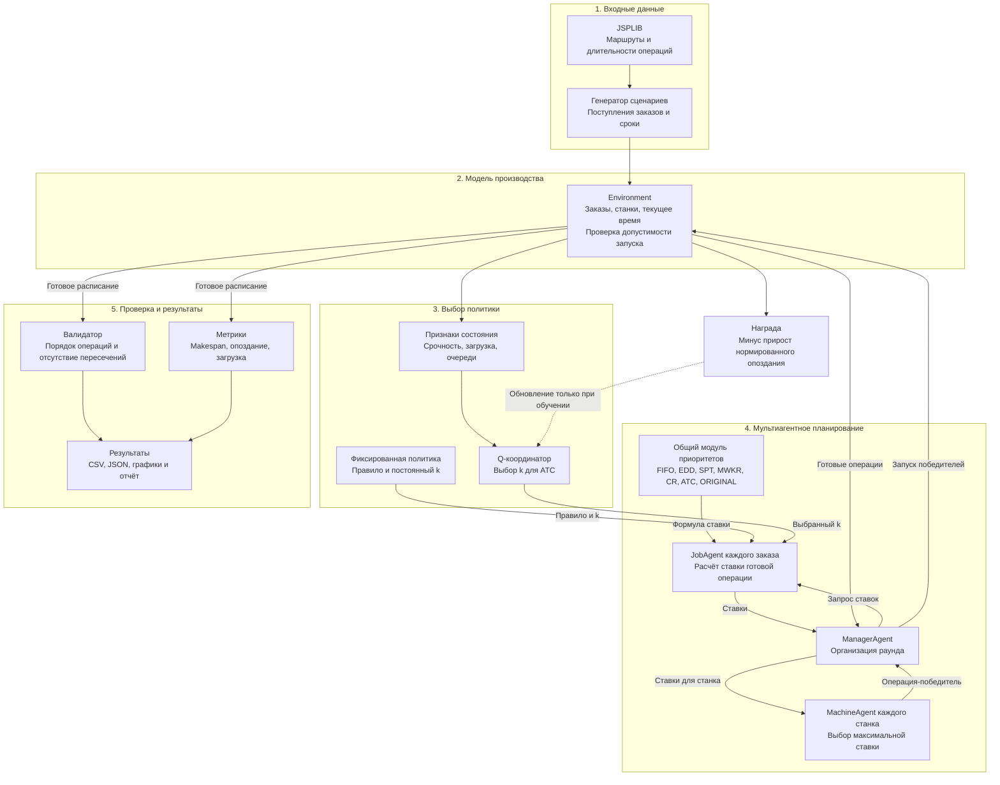
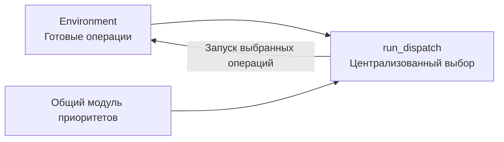

# Архитектура системы

Система строит расписания Job Shop: заказы проходят заданные последовательности
операций на станках. Агенты выбирают следующие операции, а событийная среда
контролирует допустимость запуска и движение времени. Все компоненты выполняются
в одном процессе; стрелки показывают вызовы и передачу данных, а не сетевые сообщения.

## Общая схема

Q-координатор участвует только в адаптивном режиме. При фиксированной политике
правило и параметр k задаются заранее. Пунктирная обратная связь работает только
при обучении: применение сохранённой модели не обновляет Q-таблицу.

## Как проходит один раунд

1. Environment определяет операции, которые можно начать сейчас: заказ поступил,
   предыдущая операция завершилась, нужный станок свободен.
2. В адаптивном режиме координатор получает признаки состояния и выбирает одно
   значение k из 0.5, 1.0, ..., 5.0 для всех аукционов текущего раунда.
3. ManagerAgent запрашивает ставки у JobAgent. Ставка — числовой приоритет операции.
4. Каждый MachineAgent выбирает максимальную ставку среди своих кандидатов.
   Равенства разрешаются по идентификатору заказа, затем номеру операции.
5. ManagerAgent запускает победителей через Environment. Разные свободные станки
   могут начать обработку одновременно. Начатые операции не прерываются.
6. Когда доступных запусков нет, время переходит к ближайшему поступлению заказа
   или завершению обработки. Цикл продолжается до фактического завершения всех заказов.

Среда разрешает только допустимые действия независимо от выбранной политики.
Срок заказа служит целью оптимизации: его нарушение увеличивает опоздание,
но само по себе не делает расписание недопустимым.

## Централизованный вариант для сравнения

Централизованный вариант вычисляет приоритеты напрямую. Агентный вариант передаёт
те же значения как ставки. При одинаковой формуле, информации и разрешении равенств
получаются одинаковые расписания. Стенд проверяет это сравнением их хешей.

Поэтому текущий аукцион — кооперативный однораундовый выбор по приоритету.
Цен, платежей, бюджетов и стратегического изменения ставок нет. Файлы в auction/
пока являются заготовками; действующий механизм находится в agents/agents.py.

## Где находится обучаемая часть

TabularKAgent хранит оценки Q для пар «состояние — значение k». Наблюдение включает
резерв времени, долю занятых станков, разброс сроков, долю срочных операций и
отношение готовых операций к свободным станкам. Численные признаки разбиваются
на интервалы. Это агрегированное наблюдение, его строгая марковость не установлена.

DispatchEpisode связывает среду, аукционные раунды и награду. Во время обучения
run_episode вызывает TabularKAgent.update после перехода. Награда равна минусу
приращения суммарного опоздания, делённому на общий объём обработки сценария.
Makespan измеряется отдельно и не входит в текущую награду.

При применении модели выбирается k по сохранённой таблице. Для неизвестного
состояния используется настроенное фиксированное k. Обучаемый компонент один:
это координатор над агентной системой, а не распределённое обучение всех агентов.

## Компоненты и файлы

| Компонент | Реализация |
|---|---|
| Чтение JSPLIB | [utils/loaders.py](../src/mas_jssp/utils/loaders.py) |
| Генератор сценариев обучения | [learning_data.py](../src/mas_jssp/learning_data.py) |
| Среда, заказы, операции, станки | [environment/environment.py](../src/mas_jssp/environment/environment.py) |
| Формулы приоритетов | [environment/priority.py](../src/mas_jssp/environment/priority.py) |
| Централизованный планировщик | [environment/heuristics.py](../src/mas_jssp/environment/heuristics.py) |
| Агенты и аукционный раунд | [agents/agents.py](../src/mas_jssp/agents/agents.py) |
| Q-координатор и обучающий эпизод | [agents/adaptive_atc.py](../src/mas_jssp/agents/adaptive_atc.py) |
| Метрики и валидация | [metrics/](../src/mas_jssp/metrics/) |
| Обучение и финальная оценка | [run_learning_experiment.py](../scripts/run_learning_experiment.py) |
| Применение сохранённой модели | [run_adaptive_agent.py](../scripts/run_adaptive_agent.py) |
| Сохранённые Q-таблицы | [models/](../results/adaptive_atc_v1/models/) |

Подробности протокола train/validation/test: [описание обучаемого ATC](adaptive_atc.md).
Полученные результаты и ограничения: [отчёт об эксперименте](adaptive_atc_results.md).
