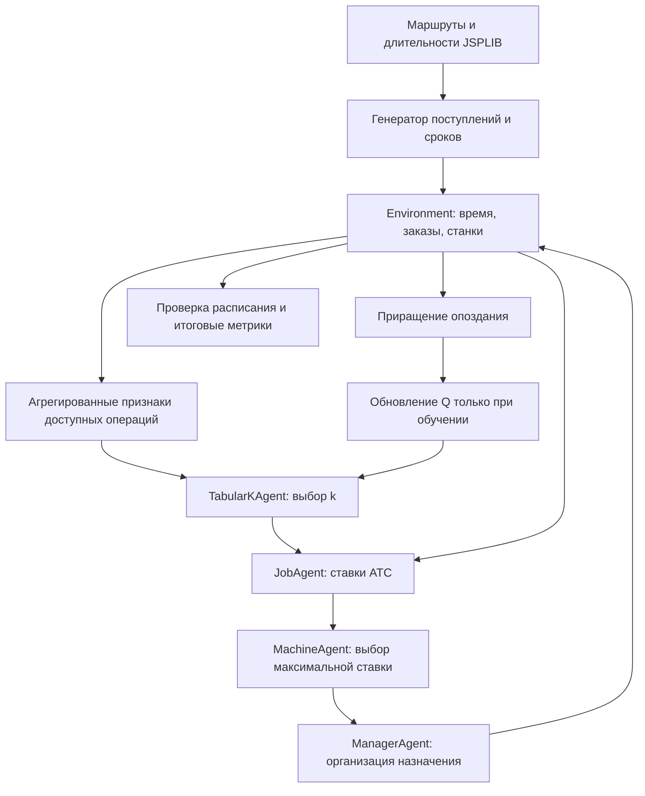
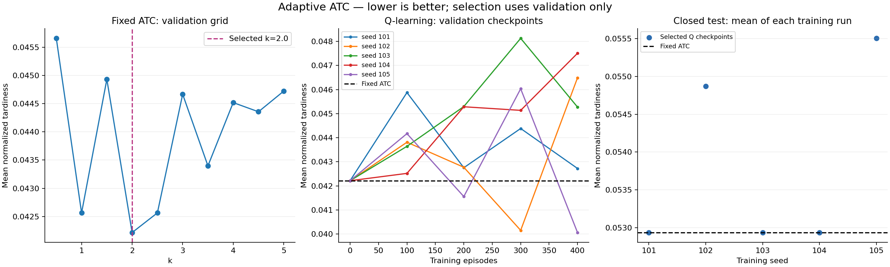

# Полный отчёт по этапу исследования с табличным Q-learning

**Дата подготовки:** 3 октября 2026 года.

**Границы отчёта:** событийная модель JSSP, базовая аукционная диспетчеризация, сравнение правил и адаптивный выбор параметра ATC табличным Q-learning. Другие экспериментальные варианты в этот отчёт не входят. Дата подготовки документа не является датой повторного проведения экспериментов.

**Тема:** «Разработка и исследование мультиагентной системы с аукционным механизмом для динамического календарного планирования в задаче Job Shop Scheduling».

**Текущий результат:** разработан прототип мультиагентной системы, проведено сравнение с правилами диспетчеризации и реализован первый обучаемый агент, динамически выбирающий параметр правила ATC. На закрытой тестовой выборке агент не показал статистически подтверждённого улучшения относительно настроенного фиксированного ATC. Результат сохранён без дополнительной подгонки.

## 1. Какую задачу решает система

В Job Shop Scheduling имеется несколько заказов и станков. Каждый заказ состоит из последовательности операций. Для каждой операции известны требуемый станок и длительность.

Расписание должно выполнять ограничения:

- один станок не может одновременно выполнять две операции;
- операции заказа выполняются в заданном порядке;
- операция начинается после поступления заказа и завершения предыдущей операции;
- начатая операция не прерывается.

Система работает в динамическом режиме: заказы могут поступать в разные моменты. При освобождении станка требуется выбрать следующую операцию.

Исследуются два показателя:

- **makespan** — момент завершения последней операции партии;
- **суммарное опоздание** — сумма превышений сроков завершения заказов.

Критерии не эквивалентны: расписание с меньшим makespan может хуже соблюдать индивидуальные сроки. В эксперименте с обучаемым агентом главным критерием выбрано нормированное суммарное опоздание. Makespan рассчитывается как дополнительная метрика.

### 1.1. Формальная постановка

Пусть заказ j состоит из операций O(j,1), ..., O(j,n_j). У каждой операции заданы станок m(j,h) и положительная длительность p(j,h). Для заказа заданы момент поступления r_j и срок d_j. Требуется определить время начала S(j,h).

- Доступность: S(j,1) ≥ r_j.
- Технологический порядок: S(j,h+1) ≥ S(j,h) + p(j,h).
- Занятость: интервалы выполнения операций на одном станке не пересекаются.
- Прерывания запрещены; заданный маршрут заказа не меняется.

Время завершения заказа C_j = S(j,n_j) + p(j,n_j). Основные показатели:

```text
Cmax = max_j C_j
T_j = max(C_j − d_j, 0)
total_tardiness = sum_j T_j
W = sum всех длительностей операций
normalized_tardiness = total_tardiness / W
```

Если сроков нет, опоздание не определено и выводится как N/A. Нулевое опоздание при заданных сроках означает, что все заказы завершились вовремя. Единицы времени условные: без привязки к производственным данным их нельзя автоматически называть минутами.

### 1.2. Исследовательские вопросы

1. Как правила формирования приоритета влияют на makespan и соблюдение сроков?
2. Меняет ли аукционная организация расписание относительно централизованного выбора с той же формулой?
3. Улучшает ли адаптивный выбор k результат относительно фиксированного ATC, честно настроенного на validation?

Рабочая гипотеза второго этапа: агрегированные признаки текущей ситуации могут помочь выбирать k и уменьшать нормированное опоздание на новых сценариях. Гипотеза проверяется экспериментально; преимущество обучения заранее не предполагается.

## 2. Структура системы

**Environment** хранит модельное время, заказы и станки. Среда проверяет допустимость запуска, фиксирует занятость и переводит время к следующему событию: поступлению заказа или освобождению станка.

**JobAgent** представляет заказ. Когда следующая операция готова, агент вычисляет числовую ставку. Чем выше ставка, тем приоритетнее операция.

**MachineAgent** представляет станок. Он получает ставки операций, которым нужен этот станок, и выбирает победителя.

**ManagerAgent** собирает ставки, проводит однораундовый выбор на каждом свободном станке и передаёт выбранные операции среде.

Один цикл принятия решения:

1. Среда определяет готовые операции.
2. Агенты заказов формируют ставки.
3. Агент каждого станка выбирает максимальную ставку.
4. Операции-победители запускаются.
5. Если запуск невозможен, время переводится к следующему событию.

«Аукцион» здесь означает выбор по числовым ставкам. Платежи, бюджеты и стратегическое поведение пока не реализованы. Это кооперативная мультиагентная диспетчеризация с аукционным принципом выбора.

Объект распределения — ближайшая возможность обработки на свободном станке. Агенты заказов являются участниками, агент станка выбирает максимальную ставку. При равных ставках используется детерминированное разрешение равенств по идентификаторам заказа и операции. Реализация работает в одном процессе Python; сетевое взаимодействие и отдельные процессы для каждого агента не требуются.

Например, если станок свободен, а три готовых заказа предлагают ставки 0,12; 0,35 и 0,21, выбирается второй заказ. Остальные продолжают ждать. Эти числа иллюстративные: в реализации ATC сравниваются логарифмы приоритетов, что сохраняет порядок победителей.



При фиксированном ATC вместо Q-агента используется постоянное k. Для FT10 создаются 10 агентов заказов и 10 агентов станков, один координатор и, в адаптивном варианте, один обучаемый агент выбора k. Наличие нескольких агентов не означает, что все они обучаются.

## 3. Сравниваемые правила

| Метод | Идея |
|---|---|
| FIFO | Раньше вошедшая в очередь операция получает приоритет |
| EDD | Приоритет заказу с ближайшим сроком |
| SPT | Приоритет самой короткой операции |
| MWKR | Приоритет заказу с наибольшим оставшимся объёмом работ |
| CR | Приоритет по отношению времени до срока к оставшейся работе |
| ATC_LOCAL | Учитывает длительность операции и резерв до срока |
| ORIGINAL | Исходная формула ставки проекта |

Для ATC_LOCAL используется приоритет:

**log I = −log p − max(d − t − R, 0) / (k × p_mean),**

где p — длительность операции, d — срок заказа, t — текущее время, R — оставшаяся обработка, p_mean — средняя длительность готовых операций на станке, k — параметр чувствительности.

Централизованный алгоритм и мультиагентная реализация при одинаковой формуле выбирают одинаковые операции. Поэтому само представление алгоритма в виде агентов без изменения правил не должно автоматически улучшать расписание.

### 3.1. Происхождение и точные различия методов

FIFO, EDD, SPT, MWKR и CR — известные правила диспетчеризации. ATC опирается на известный подход Apparent Tardiness Cost, однако ATC_LOCAL является адаптацией к нашей модели: используется оставшаяся обработка всего заказа и локальная средняя длительность кандидатов на станок. Полное воспроизведение опубликованного алгоритма ATC не заявляется.

В общем модуле все приоритеты приводятся к соглашению «больше — лучше»: FIFO использует отрицательное время готовности операции, EDD — отрицательный срок, SPT — отрицательную длительность, MWKR — оставшийся объём, CR — отрицательное отношение (d − t) / R.

ORIGINAL — название исходной эвристики проекта, а не общепринятый алгоритм из статьи:

```text
I_original = R + 100 / max(d − t, 0.000001)
```

При отсутствии срока добавка равна нулю. Число 100 — коэффициент эвристики; его оптимальность не доказана. Реальные варианты сравнения: FIFO, EDD, SPT, MWKR, CR, ATC_LOCAL, CENTRAL_ORIGINAL, AUCTION_ORIGINAL, AUCTION_ATC — всего девять.

Малое k сильнее уменьшает приоритет заказов с положительным запасом времени; большое k ослабляет влияние сроков и приближает выбор к SPT. Если у всех кандидатов запас неположительный, соответствующий штраф в формуле ATC равен нулю и изменение k не меняет их порядок. Даже в других ситуациях разные k могут приводить к одному победителю.

## 4. Что реализовано

На первом этапе:

1. Исправлена событийная модель времени.
2. Добавлено время поступления заказа.
3. Запрещены пересечения на станке и нарушения маршрута.
4. Создан общий модуль приоритетов.
5. Исправлена трактовка FIFO.
6. Добавлен независимый валидатор расписаний.
7. Реализованы массовые эксперименты и сохранение параметров, хешей и результатов.

На втором этапе:

1. Фиксированный параметр ATC подбирается только на validation.
2. Train, validation и test используют разные seed поступлений и сроков.
3. Реализован табличный Q-learning с дискретным выбором k.
4. Выполнены независимые запуски обучения.
5. Модели зафиксированы до открытия test.
6. Рассчитаны доверительные интервалы и критерий Уилкоксона.

При подготовке отчёта 3 октября 2026 года повторно подтверждено прохождение **51 автоматического теста**: проверки среды, диспетчеризации и адаптивного ATC. По сохранённым результатам все **1134 расписания** первого эксперимента и все **900 расписаний** закрытого теста обучаемого агента прошли валидатор. Проверка корректности не является доказательством оптимальности расписаний.

## 5. Первый эксперимент: фиксированные правила

Использованы девять экземпляров JSPLIB: FT06, FT10, FT20, LA01, LA16, LA31, ABZ5, TA51 и TA71. Размеры — от 6 × 6 до 100 × 20, то есть до 2000 операций.

**9 экземпляров × 14 сценариев × 9 методов = 1134 прогона.**

На один экземпляр приходятся один статический сценарий без сроков, три сценария со сроками при коэффициентах 1,5; 2; 3 и десять сценариев поступлений: два коэффициента срока 1,5 и 2, каждый с пятью seed. Это 14 сценариев, а не 14 независимых исходных датасетов.

Сроки и поступления отсутствуют в исходных JSPLIB и генерируются отдельно. Все методы получают одинаковые сценарии.

### Makespan статических задач

| Экземпляр | Оптимум | FIFO | SPT | MWKR / исходный аукцион |
|---|---:|---:|---:|---:|
| FT06 | 55 | 65 | 88 | 61 |
| FT10 | 930 | 1184 | 1074 | 1108 |
| FT20 | 1165 | 1645 | 1267 | 1501 |
| LA01 | 666 | 772 | 751 | 735 |
| LA16 | 945 | 1180 | 1156 | 1054 |
| LA31 | 1784 | 1918 | 1951 | 1931 |
| ABZ5 | 1234 | 1467 | 1352 | 1369 |
| TA51 | 2760 | 3590 | 3856 | 3435 |
| TA71 | Не указан | 6270 | 6232 | 6036 |

Исходный аукцион разделил лучший результат среди реализованных методов на пяти из девяти задач. Но без сроков его формула совпадает с MWKR. Это показывает качество формулы на части экземпляров, а не отдельное преимущество аукционной организации.

Лучший результат среди исследованных эвристик не обязательно оптимален. Например, для FT10 получено 1108 при известном оптимуме 930.

### Опоздание

| Метод | Заказы доступны сразу | Поступления во времени |
|---|---:|---:|
| EDD | −58,66% | −37,36% |
| SPT | −45,47% | −31,66% |
| MWKR | +17,91% | +89,56% |
| CR | −42,56% | −30,79% |
| ATC_LOCAL / AUCTION_ATC | **−60,17%** | **−48,33%** |
| ORIGINAL / AUCTION_ORIGINAL | +10,85% | +43,41% |

Это среднее парное относительное изменение суммарного опоздания относительно FIFO. Отрицательное значение означает улучшение. В проверенных сценариях ATC_LOCAL показал лучший средний относительный результат. Первый этап был описательным: статистическая гипотеза заранее не задавалась.

Из относительного показателя исключены сценарии с нулевым опозданием FIFO, поскольку деление на ноль невозможно: для сроков учтена 21 пара из 27, исключено 6; для поступлений учтены 74 пары из 90, исключено 16. Проценты рассчитаны как среднее индивидуальных относительных изменений, а не как отношение средних. Поэтому их нельзя напрямую сопоставлять с процентами второго этапа.

Оптимумы статических задач применимы только к исходным экземплярам. После добавления поступлений и сроков нельзя использовать исходный оптимум как доказанный оптимум нового сценария. В частности, Q-learning не проверялся в этом исследовании на TA51 и TA71: крупные задачи входят в первый, необучаемый этап.

## 6. Второй эксперимент: обучаемый выбор k

Обучается один координатор. Перед раундом аукциона он выбирает k из набора 0,5; 1,0; 1,5; ...; 5,0. После этого агенты заказов рассчитывают ставки ATC с выбранным k, а агенты станков проводят обычный выбор.

Это иерархическая система с одним обучаемым координатором, а не распределённое multi-agent reinforcement learning.

Агент наблюдает пять агрегированных признаков:

- средний резерв времени заказов;
- долю занятых станков;
- разброс времени до сроков;
- долю срочных заказов;
- отношение готовых операций к свободным станкам.

После дискретизации возможно 432 состояния. Действие — одно из десяти значений k. Награда равна отрицательному приращению нормированного опоздания. Makespan в награду не входит.

Использованы FT06, FT10, FT20, LA01 и LA16:

| Часть | Сценариев | Назначение |
|---|---:|---|
| Train | 400 | Обновление Q-таблицы |
| Validation | 50 | Выбор k, alpha и checkpoint |
| Test | 150 | Окончательное сравнение |

Проверялись alpha=0,1 и alpha=0,3, пять независимых seed обучения и 400 эпизодов. Validation выбрала baseline ATC с k=2,0 и alpha=0,1.

### 6.1. Откуда берутся обучающие сценарии

Готовые файлы JSPLIB содержат маршруты и длительности. Динамические условия добавляются программно:

```text
release_time ~ Uniform(0, W / число станков)
factor_j ~ Uniform(1.2, 2.8)
due_date_j = release_time_j + factor_j × сумма длительностей заказа j
```

Для поступлений и сроков используются отдельные генераторы, полученные из имени задачи, seed и имени потока через SHA-256. Одинаковые исходные данные, настройки и seed воспроизводят один сценарий. Полные сценарии создаются в памяти; в репозитории сохранены исходные задачи, генератор и параметры для их восстановления.

| Выборка | Seed на каждый экземпляр | Число seed | Всего на пяти экземплярах |
|---|---|---:|---:|
| Train | 10000–10079 | 80 | 400 |
| Validation | 20000–20009 | 10 | 50 |
| Test | 30000–30029 | 30 | 150 |

Seed сценария определяет производственную ситуацию; seed обучения определяет порядок учебных сценариев и исследовательские действия агента. Это два разных источника случайности. Начальные Q-значения во всех запусках равны нулю.

### 6.2. Что хранит и как учится агент

Q(s,a) — оценка будущей суммарной награды при выборе действия a в состоянии s и последующем продолжении. Действие соответствует одному значению k. Нейросети в этом варианте нет.

```text
Q(s,a) ← Q(s,a) + alpha × [r + gamma × max_a' Q(s_next,a') − Q(s,a)]
```

Использовано gamma=1. На последнем переходе будущая ценность принимается равной нулю. Во время обучения применяется epsilon-greedy: с вероятностью epsilon выбирается случайное действие, иначе — действие с максимальной оценкой. Epsilon линейно уменьшается с 0,3 до 0,05. На validation и test epsilon=0, таблица и счётчики не изменяются.

Агент не получает будущие заказы в наблюдении. Пять признаков вычисляются по доступным операциям: средний (d−t−R)/R; доля недоступных станков; стандартное отклонение d−t, делённое на среднюю длительность кандидатов; доля заказов с d−t−R ≤ 0; число кандидатов на свободный станок. Разбиение признаков на 4 × 3 × 3 × 3 × 4 интервала даёт 432 состояния и 10 действий на состояние. В JSON сохраняются только созданные строки таблицы и счётчики посещений.

Неизвестное состояние использует выбранное на validation фиксированное k. При равенстве оценок предпочтение также отдаётся этому k. Поэтому начальная пустая таблица воспроизводит фиксированную политику.

Агрегированные признаки не гарантируют марковость: две различные производственные ситуации могут выглядеть для агента одинаково. Шаги имеют разную длительность модельного времени. Поэтому это практическое применение Q-learning к частично наблюдаемой событийной задаче; теоретическая сходимость к оптимальной политике здесь не доказана.

### 6.3. Награда простыми словами

Штраф накапливается, пока заказ уже просрочен, но ещё не завершён. После его завершения начисление прекращается. Если A(t) — накопленное опоздание, то награда за переход:

```text
r = −(A(t_next) − A(t)) / W
сумма наград эпизода = −total_tardiness / W
```

Чем ближе суммарная награда к нулю, тем лучше. Нулевая награда за весь эпизод означает отсутствие опозданий, а не отсутствие работы агента. Нормировка W используется как масштаб награды, а не как признак для просмотра будущих поступлений. Makespan в награду не входит: снижать его агент специально не обучался.

### 6.4. Как исключалась подгонка под тест

1. Зафиксированы выборки, критерий и параметры эксперимента в protocol.json.
2. По 50 validation-сценариям перебраны десять k от 0,5 до 5,0 с шагом 0,5; выбран k=2.
3. Для каждой alpha обучены пять моделей с seed 101–105: всего десять запусков обучения.
4. Каждый запуск обучался 400 эпизодов, с оценкой на validation каждые 100 эпизодов. Также оценивался checkpoint 0.
5. Для каждого запуска выбран лучший checkpoint, затем одна общая alpha по среднему validation-качеству пяти запусков.
6. Пять выбранных моделей, их контрольные суммы и параметры сохранены в selection.json до открытия test.
7. На test модели только применялись; исходные результаты защищены от повторной записи штатным скриптом.

В данном запуске 400 эпизодов соответствуют одному проходу 400 учебных сценариев, а не 400 полным проходам обучающей выборки. Выбор checkpoint не означает досрочное прекращение вычислений: все запуски дошли до заданного бюджета.

## 7. Результаты Q-learning

| Метрика | ATC, k=2 | Q-агент | Изменение |
|---|---:|---:|---:|
| Нормированное опоздание | **0,052935** | 0,053836 | +1,70% |
| Суммарное опоздание | **247,327** | 251,471 | +1,68% |
| Makespan | **1097,918** | 1098,881 | +0,088% |

Для главной метрики 95%-й bootstrap-интервал разности Q − ATC равен **[−0,000491; 0,003124]**. Интервал включает ноль. Двусторонний критерий Уилкоксона дал **p=0,144**. При уровне значимости 0,05 статистически значимого различия не обнаружено. По 30 блокам seed агент получил 11 побед, 1 равенство и 18 проигрышей.

По makespan методы практически равны: Q-агент хуже в среднем на 0,962, или на 0,088%. Интервал разности равен [−1,621; 4,636], побед и проигрышей поровну — 15 и 15. Это описательная метрика, поскольку главная статистическая гипотеза задавалась для опоздания.

В трёх из пяти выбранных запусков validation предпочла checkpoint 0, то есть исходную фиксированную политику. Только в двух запусках выбраны обученные Q-таблицы, но их validation-улучшение не перенеслось на среднее test-качество.

### 7.1. Выбранные модели

| Seed обучения | Выбранный эпизод | Validation: нормированное опоздание | Test: среднее нормированное опоздание |
|---|---:|---:|---:|
| 101 | 0 | 0,042214 | 0,052935 |
| 102 | 300 | 0,040152 | 0,054870 |
| 103 | 0 | 0,042214 | 0,052935 |
| 104 | 0 | 0,042214 | 0,052935 |
| 105 | 400 | 0,040060 | 0,055506 |

Baseline на validation равен 0,042214. Все пять выбранных вариантов входят в итоговую оценку; после просмотра test не выбирался один наиболее удачный seed. Модели с эпизодом 0 корректнее называть выбранной исходной политикой, а не успешно обученной моделью. Файлы с суффиксом _last содержат окончательные таблицы после 400 эпизодов и могут отличаться от выбранных checkpoint.

### 7.2. Что именно означает статистика

900 тестовых расписаний получены как 150 сценариев × (один baseline + пять выбранных моделей). Это не 900 независимых задач. Для критерия Уилкоксона результаты усреднялись по моделям и пяти фиксированным экземплярам, оставляя 30 парных seed-блоков. Нулевые разности обрабатывались методом Pratt.

Для доверительных интервалов использованы 5000 bootstrap-повторов с seed 7401: независимо пересэмплировались запуски обучения и seed-блоки сценариев, а панель из пяти экземпляров оставалась фиксированной. Стандартное отклонение пяти средних результатов моделей по нормированному опозданию равно 0,001254. Это разброс между средними запусков, а не разброс всех отдельных расписаний.

Значение p=0,144 не означает «вероятность бесполезности агента 14,4%». Оно означает, что выбранный тест не обнаружил значимого различия при уровне 0,05. Отсутствие значимости не доказывает равенство методов. Средняя разность при этом положительная, то есть в наблюдаемом эксперименте агент в среднем немного хуже.

### 7.3. График обучения и проверки



Левая часть показывает подбор фиксированного k на validation. Средняя — изменение validation-качества по мере обучения. Правая — среднее test-качество выбранных моделей. Меньшее опоздание лучше. Validation и test содержат разные сценарии, поэтому их абсолютные уровни могут различаться. Улучшение средней кривой на validation само по себе не гарантирует улучшения test.

## 8. Интерпретация

Простой Q-learning не превзошёл настроенный фиксированный ATC. Это не доказывает бесполезность машинного обучения или более сложного RL.

Возможные причины, требующие проверки:

- агрегированные признаки теряют важную информацию;
- разные ситуации попадают в одно дискретное состояние;
- изменение k не всегда меняет победителя;
- фиксированное k=2 уже близко к хорошему решению;
- редко встречающиеся состояния недостаточно изучены.

Для проверенной панели и распределения сценариев разумный базовый выбор — ATC_LOCAL с k=2. Это не утверждение об универсально лучшем k для любого предприятия или датасета. Q-агент остаётся исследовательским прототипом.

Отрицательный результат полезен: baseline настроен честно, test не использовался для подбора, неопределённость оценена статистически. Нельзя утверждать, что добавление ИИ автоматически улучшило систему.

## 9. Результаты работы

1. Разработана событийная модель динамического JSSP.
2. Реализованы агенты заказов и станков и однораундовый аукцион.
3. Добавлены правила диспетчеризации и адаптация ATC.
4. Проведено сравнение на девяти JSPLIB-задачах до 2000 операций.
5. Показана эквивалентность агентного и централизованного исполнения одинаковой формулы.
6. Реализован обучаемый координатор выбора параметра ATC.
7. Построен протокол с раздельными train, validation и test.
8. Получен воспроизводимый результат: табличный агент не превзошёл настроенный ATC.

Самостоятельное преимущество аукционного механизма пока не установлено. Сейчас его ценность состоит в модульном распределении решений. Для исследования собственного эффекта аукциона нужны локальные цели, ограничения информации, бюджеты, переговоры или другой протокол.

## 10. Ограничения

- Поступления и сроки синтетические.
- Исследуется конечная партия, а не непрерывный поток.
- В train, validation и test общая панель маршрутов; меняются поступления и сроки.
- Поломки и восстановление станков не реализованы.
- Нет цен и бюджетов.
- Используется один обучаемый координатор.
- Пять обучений дают предварительную оценку устойчивости.
- Главная статистическая гипотеза задана только для опоздания.

Дополнительно: обучение использует 400 эпизодов на запуск и постоянную alpha; достаточность этого бюджета не установлена. Нулевые начальные оценки при неположительных наградах могут делать ещё не изученные действия привлекательными — этот эффект требует диагностики. Отдельного исследования времени обмена сообщениями, распределённых вычислений и устойчивости к сбоям агентов не проводилось.

## 11. Следующий этап

Сначала необходимо выбрать главный критерий диплома.

Если главным остаётся опоздание:

1. Измерить, как часто изменение k меняет победителя.
2. Исследовать посещаемость состояний и неизвестные состояния на test.
3. Добавить признаки очередей и оставшихся маршрутов.
4. Сравнить выбор k с выбором правила из SPT, EDD, CR и ATC.
5. После изменений создать новый закрытый test с другими seed.

Приоритетная диагностическая серия: сравнить бюджеты 400, 2000 и 4000 эпизодов только по train/validation; посчитать посещения пар «состояние–действие» и долю решений, где выбор k меняет победителя. Сначала следует проверить, есть ли у выбранного действия достаточное влияние на расписание. Это план будущей работы, а не уже выполненный эксперимент.

Если главным становится makespan, нужно изменить награду, выбирать модель по validation makespan и проверять её на новом test. Подстраиваться под уже открытый test нельзя.

## 12. Вопросы научному руководителю

1. Какую метрику считать главной: makespan или опоздание?
2. Достаточно ли поступлений заказов или нужны поломки станков?
3. Нужно ли развивать цены, бюджеты и локальные интересы агентов?
4. Достаточен ли табличный агент с отрицательным результатом?
5. Требуется ли перенос на полностью новые маршруты и размеры задач?

## 13. Воспроизводимость

Базовая версия сохранена тегом baseline-v1. Обучаемая версия находится в ветке codex/adaptive-atc-v1 и отмечена тегом adaptive-atc-v1.

Основные материалы:

- results/benchmark/runs.csv — 1134 запуска;
- results/adaptive_atc_v1/test_runs.csv — 900 тестовых расписаний;
- results/adaptive_atc_v1/test_summary.json — статистика;
- results/adaptive_atc_v1/protocol.json — протокол и контрольные суммы;
- results/adaptive_atc_v1/models/ — Q-таблицы;
- docs/adaptive_atc.md — описание алгоритма.

Проверка тестов:

    python -m pytest tests/test_environment.py tests/test_dispatch.py tests/test_adaptive_atc.py -q

Повторный запуск:

    python scripts/run_learning_experiment.py --output results/adaptive_atc_repeat
    python scripts/plot_learning_experiment.py --results results/adaptive_atc_repeat

Запуск с прежними seed проверяет воспроизводимость, но не создаёт новый независимый test.

### 13.1. Демонстрация при научном руководителе

Команды выполняются из корня проекта. В чистой копии сначала устанавливаются зависимости:

```powershell
python -m pip install -e ".[dev,learning]"
```

Если рабочее окружение уже установлено, повторная установка перед демонстрацией не нужна.

**Обычные алгоритмы на FT10 без сроков:**

```powershell
python run_experiment.py data/benchmarks/ft10.txt --scenario static
```

Ожидаемые makespan: FIFO 1184; SPT и ATC_LOCAL 1074; MWKR и AUCTION_ORIGINAL 1108. Опоздание N/A, поскольку сроков нет. CPU runtime зависит от компьютера и не равен модельному makespan.

**Динамическая задача со сроками:**

```powershell
python run_experiment.py data/benchmarks/ft10.txt --scenario arrivals --due-factor 2 --seed 0
```

**Применение сохранённой Q-таблицы без повторного обучения:**

```powershell
python scripts/run_adaptive_agent.py data/benchmarks/ft10.txt --model results/adaptive_atc_v1/models/q_alpha0.1_seed102.json --seed 30000
```

Для последней команды ранее получен следующий воспроизводимый пример:

| Показатель | Фиксированный ATC, k=2 | Выбранная модель seed 102 |
|---|---:|---:|
| Суммарное опоздание | 41,876565 | 0 |
| Нормированное опоздание | 0,008197 | 0 |
| Makespan | 1370,399858 | 1313,008912 |
| Число решений | 77 | 70 |
| Решения с конкуренцией | 17 | 15 |
| Допустимость | true | true |

В этом отдельном сценарии агент устранил опоздания и уменьшил makespan примерно на 4,19%. Сценарий уже просмотрен и используется только как демонстрация. Он не опровергает отрицательный средний результат 150 тестовых сценариев и не должен выдаваться за доказательство общего превосходства.

Значения полей вывода:

- decisions — число раундов принятия решений, не число операций;
- conflict_decisions — число раундов, где хотя бы на одном станке конкурировали несколько кандидатов;
- k_counts — сколько раз выбиралось каждое k; разные k не обязательно означают разных победителей;
- unseen_fraction — доля решений с отсутствующим в таблице состоянием; ноль не означает, что весь сценарий уже был в обучении;
- reward_sum — отрицательное нормированное опоздание за весь эпизод;
- valid — результат проверки ограничений расписания.

Скрипты run_experiment.py и run_adaptive_agent.py используют разные генераторы сценариев. Одинаковый числовой seed в этих командах не обеспечивает одинаковые поступления и сроки. Корректно сравнивать методы внутри одного запуска с общими условиями.

### 13.2. Где находятся код, данные и результаты

| Путь от корня репозитория | Содержимое |
|---|---|
| [data/benchmarks/](../data/benchmarks/) | Маршруты, длительности и manifest с метаданными |
| [src/mas_jssp/environment/environment.py](../src/mas_jssp/environment/environment.py) | Событийная среда и ограничения запуска |
| [src/mas_jssp/environment/priority.py](../src/mas_jssp/environment/priority.py) | Формулы приоритета |
| [src/mas_jssp/environment/heuristics.py](../src/mas_jssp/environment/heuristics.py) | Централизованное применение правил |
| [src/mas_jssp/agents/agents.py](../src/mas_jssp/agents/agents.py) | Агенты заказов, станков и координатор |
| [src/mas_jssp/agents/adaptive_atc.py](../src/mas_jssp/agents/adaptive_atc.py) | Состояние, действия, награда, Q-learning и применение модели |
| [src/mas_jssp/learning_data.py](../src/mas_jssp/learning_data.py) | Генератор и разделение сценариев |
| [src/mas_jssp/learning_statistics.py](../src/mas_jssp/learning_statistics.py) | Агрегация, интервалы и парный тест |
| [scripts/run_learning_experiment.py](../scripts/run_learning_experiment.py) | Подбор baseline, обучение, выбор модели и итоговый test |
| [results/benchmark/runs.csv](../results/benchmark/runs.csv) | 1134 измерения первого этапа |
| [results/adaptive_atc_v1/protocol.json](../results/adaptive_atc_v1/protocol.json) | Выборки, параметры и контрольные суммы |
| [results/adaptive_atc_v1/validation_grid.csv](../results/adaptive_atc_v1/validation_grid.csv) | Подбор фиксированного k |
| [results/adaptive_atc_v1/training_history.csv](../results/adaptive_atc_v1/training_history.csv) | Проверки качества на checkpoint; не полный журнал переходов |
| [results/adaptive_atc_v1/selection.json](../results/adaptive_atc_v1/selection.json) | Выбранные k, alpha, checkpoint и модели |
| [results/adaptive_atc_v1/models/](../results/adaptive_atc_v1/models/) | Q-таблицы, действия, параметры и посещения; выбранные и последние модели |
| [results/adaptive_atc_v1/test_runs.csv](../results/adaptive_atc_v1/test_runs.csv) | Метрики и диагностика 900 тестовых расписаний |
| [results/adaptive_atc_v1/test_summary.json](../results/adaptive_atc_v1/test_summary.json) | Средние, разброс, интервалы и результаты статистического сравнения |
| [docs/adaptive_atc.md](adaptive_atc.md) | Подробное описание алгоритма и протокола |

Файлы в src/mas_jssp/auction/ — заготовки: рабочий базовый механизм распределения реализован в agents.py. CSV результатов содержит измерения запусков; его не следует путать с исходными маршрутами или обученной моделью.

### 13.3. Как повторять, сохраняя прошлые выводы

Для повторения кода этого этапа следует использовать сохранённую версию adaptive-atc-v1 или ветку с этим кодом. Оригинальная папка results/adaptive_atc_v1 является архивом эксперимента: для нового запуска нужен новый output. Ранее сохранённый protocol содержит пути и контрольные суммы исходников; перенос на другой компьютер или добавление новых исходных файлов может нарушить его проверку. В таком случае для повторения создаётся новый протокол в новой папке, а не исправляются контрольные суммы старого исследования.

Создание новой папки с прежними seed проверяет воспроизводимость. Для новой проверки после изменения метода требуется заранее выделить другие тестовые seed и зафиксировать новый протокол до просмотра результатов. Диапазоны seed старого генератора заданы в learning_data.py; новый закрытый тест нельзя получить одним переименованием output.

## 14. Короткий текст для встречи

«Я разработал динамическую систему Job Shop с агентами заказов и станков. Агенты заказов формируют ставки, а агент каждого станка выбирает операцию-победителя. Среда контролирует поступление заказов, технологический порядок и отсутствие пересечений.

Сначала я сравнил девять методов на девяти экземплярах JSPLIB. Выполнено 1134 прогона. На статических задачах исходный аукцион был среди лучших реализованных методов в пяти случаях, но его формула там совпадает с MWKR. Поэтому это результат формулы, а не доказательство преимущества аукциона. В сценариях со сроками лучший средний результат показал ATC.

Затем я добавил Q-learning: координатор выбирает параметр k для ATC. Данные разделены на train, validation и test, фиксированный ATC тоже настроен на validation. Проведено пять независимых обучений и 900 тестовых запусков.

На закрытом test Q-агент не улучшил baseline: нормированное опоздание выросло примерно на 1,7%, p-value равно 0,144. По makespan методы почти равны: различие 0,088% в пользу фиксированного ATC. Статистически подтверждённого преимущества обучения нет.

Результат показывает, что в проверенной конфигурации адаптивный выбор k по агрегированному состоянию не дал подтверждённого улучшения. Следующий вопрос — сделать главным makespan или опоздание и в зависимости от этого развивать признаки агента, выбор правил или сам аукционный протокол».

## 15. Источники

1. Panwalkar S. S., Iskander W. A. A Survey of Scheduling Rules. Operations Research, 1977. https://doi.org/10.1287/opre.25.1.45
2. Vepsalainen A. P. J., Morton T. E. Priority Rules for Job Shops with Weighted Tardiness Costs. Management Science, 1987. https://doi.org/10.1287/mnsc.33.8.1035
3. Watkins C. J. C. H., Dayan P. Q-learning. Machine Learning, 1992. https://www.gatsby.ucl.ac.uk/~dayan/papers/wd92.html
4. Wellman M. P. et al. Auction Protocols for Decentralized Scheduling. Games and Economic Behavior, 2001. https://doi.org/10.1006/game.2000.0822
5. Liu R., Piplani R., Toro C. A deep multi-agent reinforcement learning approach to solve dynamic job shop scheduling problem. Computers & Operations Research, 2023. https://doi.org/10.1016/j.cor.2023.106294
6. JSPLIB: https://github.com/tamy0612/JSPLIB, версия eea2b60dd7e2f5c907ff7302662c61812eb7efdf.

Правила диспетчеризации и Q-learning являются существующими методами. Самостоятельная часть работы — их программная интеграция в событийную агентную модель, явно описанная адаптация ATC, контроль эквивалентности централизованного и агентного назначения, воспроизводимый протокол обучения и анализ результатов. Наличие источников по аукционам и multi-agent RL в списке не означает реализации их полных протоколов. Универсальная новизна алгоритма и превосходство над современными оптимизационными решателями в работе не заявляются.
